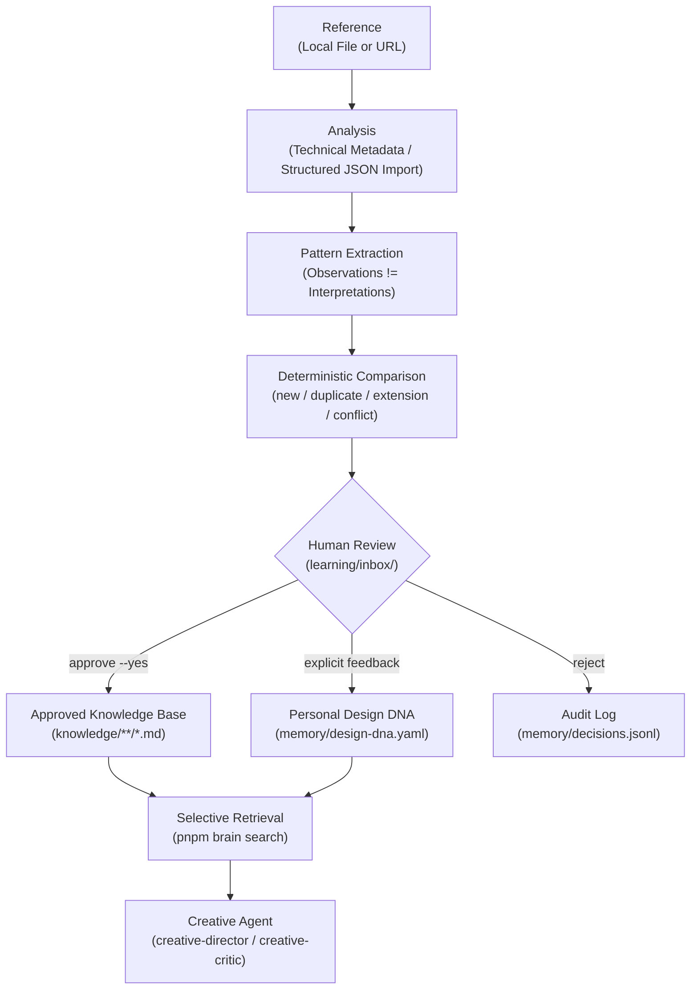

# Aesthra

**Intelligence Shaped by Taste.**

An evolving personal creative intelligence layer for AI agents — turning visual inspiration into reusable knowledge, personalized taste, and actionable creative workflows.

[](LICENSE)
[](.github/workflows/ci.yml)
[](package.json)
[](pnpm-workspace.yaml)

---

## Overview

Aesthra is a local-first creative intelligence, memory, and Agent Skills layer designed to help AI coding and creative agents make stronger aesthetic decisions across posters, editorial layouts, websites, brand systems, and motion direction.

Rather than fine-tuning model weights or dumping hundreds of raw screenshots into giant prompts, Aesthra transforms visual references into structured, source-traceable creative principles and maintains an explicit, user-governed Personal Design DNA alongside general design knowledge.

Built for designers, creative technologists, filmmakers, and engineers working with agentic coding environments such as Claude Code and Codex, Aesthra runs locally on standard Markdown, YAML, JSON, and JSONL files with zero mandatory cloud databases or paid vision APIs.

---

## The Problem

AI agents are increasingly capable of generating code, layouts, storyboards, and video pipelines, yet creative direction remains brittle across sessions:

- Visual inspiration stays trapped in scattered folders, bookmarks, and screenshots with no structured explanation of _why_ a work succeeds.
- Agents lack persistent memory of your personal aesthetic judgment—what you repeatedly embrace, avoid, or refine.
- Naive reference systems either bloat context windows with raw assets, fabricate visual analysis from URLs alone, or overwrite curated principles silently.

---

## The Solution

**Turn inspiration into intelligence.**

Aesthra implements a review-gated learning pipeline:

**Collect → Analyze → Extract → Compare → Propose → Review → Integrate → Retrieve → Create**

Every piece of knowledge traces back to its reference provenance, distinguishes direct observations from subjective interpretations, separates general design principles from personal taste, and enters curated storage only after explicit human approval.

---

## Key Features

### Implemented Capabilities

- **Reference Ingestion (`@aesthra/ingestion`)**: Register local media files (SHA-256 hashing, native PNG/JPEG/GIF/WebP/SVG dimensions) and source URLs (canonical normalization, SSRF checks, zero automatic scraping) with content-hash and canonical-URL deduplication.
- **Honest Analysis & Structured Import (`@aesthra/analysis`)**: Inspect real technical file metadata offline, import structured `CreativeAnalysis` JSON, and explicitly surface limitations whenever visual media or vision models are unavailable.
- **Pattern Comparison & Proposal Inbox (`@aesthra/knowledge`)**: Extract candidate patterns from substantive analyses, compare against existing Markdown knowledge (`new`, `similar`, `duplicate`, `extension`, `conflict`, `insufficient_evidence`), and queue reviewable proposals in `learning/inbox/`.
- **Human-Gated Curation & Safe Writes**: Inspect proposals (`inbox`, `show`), reject without mutation (`reject`), or apply atomically (`approve --yes`) with path-traversal protection and `baseFileHash` conflict detection.
- **Personal Design DNA (`@aesthra/memory`)**: Manage `memory/design-dna.yaml` and append-only `feedback.jsonl`, `preferences.jsonl`, and `decisions.jsonl` logs, keeping explicit taste separate from tentative inferences.
- **Selective Local Retrieval (`@aesthra/retrieval`)**: Progressive local keyword search (`search`) filtered by query, creative domain, and tags across approved knowledge, references, and memory.
- **Canonical Agent Skills (`skills/`)**: Five validated Agent Skills (`reference-analyzer`, `pattern-extractor`, `knowledge-curator`, `creative-director`, `creative-critic`) with cross-platform Claude Code and Codex sync (`pnpm sync:skills`).

### Optional / Conditional Capabilities

- **Video Stream Metadata (`ffprobe`)**: Automatically augments technical metadata for video references when `ffprobe` is available on `PATH`; skipped gracefully otherwise.

### Planned Capabilities

- Pluggable vision-capable multimodal LLM adapters implementing `AnalyzerProvider`.
- Automated `ffmpeg` keyframe extraction for video references.
- Embedding-backed semantic retrieval and vector store adapters (e.g., Qdrant) behind `KnowledgeRetriever` and `KnowledgeComparator`.
- Separate executable Effect Registry (e.g., Remotion, GSAP) and visual Creative Studio UI.

---

## How It Works



---

## Quick Start

### Prerequisites

- **Node.js** `>= 22.0.0`
- **pnpm** `>= 10.0.0`
- _Optional:_ `ffmpeg` / `ffprobe` (only for optional video metadata inspection)

### Setup & Verify

```bash
git clone <repository-url>
cd aesthra
pnpm install
pnpm build
pnpm brain doctor
```

### Core CLI Commands

```bash
pnpm brain --help
pnpm brain learn --file ./examples/references/sample-poster.png --notes "Strong asymmetric framing and generous negative space."
pnpm brain analyze <reference-id> --import ./examples/analyses/sample-poster-analysis.json
pnpm brain propose <reference-id>
pnpm brain inbox
pnpm brain show <proposal-id>
pnpm brain approve <proposal-id> --yes
pnpm brain search "gravitational anchor"
pnpm brain profile
```

---

## Your First Learning Session

This repository includes an original synthetic poster fixture ([`examples/references/sample-poster.png`](examples/references/sample-poster.png)) and a matching structured analysis ([`examples/analyses/sample-poster-analysis.json`](examples/analyses/sample-poster-analysis.json)) so you can run the entire workflow offline.

### 1. Register the sample reference

```bash
pnpm brain learn --file ./examples/references/sample-poster.png --notes "Strong asymmetric framing and generous negative space."
```

Output:

```text
Registered new creative reference:
Reference: ref_2b0f8d227ddc
  Title:       sample poster
  Type:        image
  Status:      registered
  Local path:  examples/references/sample-poster.png
  Hash:        sha256:ba12e74c20ae0e7feee14b541f25f84bba164b81eca7d2a1a5991d540ee469a8
  Dimensions:  600x800
  Notes:       Strong asymmetric framing and generous negative space.
```

### 2. Run technical inspection (offline fallback)

If no vision provider is configured, Aesthra reports real file metadata and discloses the limitation honestly rather than inventing visual claims:

```bash
pnpm brain analyze ref_2b0f8d227ddc
```

```text
Technical metadata inspection complete (2 observation(s)). No vision-capable AI provider is configured (AESTHRA_VISION_PROVIDER is unset). Automated visual inspection is unavailable; use --import <analysis.json> or the reference-analyzer Skill.
```

### 3. Import structured visual analysis

Whether authored manually or produced by an AI agent that viewed the image using `skills/reference-analyzer/SKILL.md`:

```bash
pnpm brain analyze ref_2b0f8d227ddc --import ./examples/analyses/sample-poster-analysis.json
```

```text
Imported structured analysis "ana_155ecffeea2f" (3 observation(s), 2 candidate pattern(s)).
```

### 4. Generate and inspect learning proposals

```bash
pnpm brain propose ref_2b0f8d227ddc
pnpm brain inbox
pnpm brain show prop_916ec3951586
```

`propose` compares extracted patterns against `knowledge/` and queues reviewable proposals in `learning/inbox/`. Nothing under `knowledge/` or `memory/` changes yet.

### 5. Approve and retrieve

```bash
pnpm brain approve prop_916ec3951586 --yes
pnpm brain search "gravitational anchor"
```

```text
Approved and applied proposal "prop_916ec3951586" -> knowledge/patterns/lower-third-gravitational-anchor.md

Search (local_keyword): "gravitational anchor" — 4 match(es)
  - [knowledge_pattern] Lower-Third Gravitational Anchor (score=11.5, patterns/graphic-design)
    Path: knowledge/patterns/lower-third-gravitational-anchor.md
    Summary: Anchoring primary visual mass in the lower-left third while leaving the upper field unbroken to establish calm vertical tension.
    Provenance: ref_2b0f8d227ddc
```

> **Note:** Private reference files (`references/catalog/*.json`, `references/analyses/*.json`, `learning/inbox/*.json`) are gitignored by default so personal inspiration libraries stay local.

---

## Architecture

Aesthra is structured as an acyclic pnpm TypeScript workspace:

```text
aesthra/
├── apps/cli/                # Commander CLI (pnpm brain / aesthra)
├── packages/
│   ├── core/                # Zod schemas, IDs, safe paths, atomic FS, workspace discovery
│   ├── ingestion/           # File hashing, media inspection, SSRF-safe URL registration
│   ├── analysis/            # Provider interface, technical analyzer, structured JSON importer
│   ├── memory/              # Personal Design DNA (YAML) + append-only JSONL logs
│   ├── knowledge/           # Markdown serialization, comparator, inbox, atomic curator
│   └── retrieval/           # Local keyword retrieval across knowledge, references, memory
├── skills/                  # Five canonical Agent Skills
├── knowledge/               # Curated Markdown knowledge base (illustrative seeds + learned entries)
├── memory/                  # Personal Design DNA + feedback/preferences/decisions JSONL logs
├── references/              # Local reference catalog, analyses, and collections
├── learning/inbox/          # Pending reviewable proposals
├── examples/                # Original synthetic fixtures, structured analysis, sample brief
├── scripts/                 # sync-skills.ts & validate-skills.ts
├── docs/                    # Architecture, workflow, schema, policy, and integration guides
└── tests/                   # Shared test helpers and end-to-end integration tests
```

See [docs/architecture.md](docs/architecture.md) for package dependencies and module boundaries.

---

## Agent Integration

Aesthra includes repository instructions for both **Codex** ([`AGENTS.md`](AGENTS.md)) and **Claude Code** ([`CLAUDE.md`](CLAUDE.md)), treating `skills/` as the single canonical source of truth.

Sync canonical Skills into agent discovery directories (`.claude/skills/` and `.agents/skills/`, both gitignored):

```bash
# Sync all skills for both Claude Code and Codex
pnpm sync:skills

# Validate all SKILL.md metadata, structure, and relative links
pnpm validate:skills
```

See [docs/agent-integration.md](docs/agent-integration.md) for runtime nuances and limitations.

---

## Knowledge Model

**Reference ≠ Knowledge ≠ Memory ≠ Skill**

| Layer         | Purpose                                              | Storage                                                   | Mutated Without Review?                   |
| ------------- | ---------------------------------------------------- | --------------------------------------------------------- | ----------------------------------------- |
| **Reference** | Source pointer, hash, provenance, observations       | `references/catalog/*.json`, `references/analyses/*.json` | Created by `learn` / `analyze`            |
| **Knowledge** | General design principles, patterns, styles, recipes | `knowledge/**/*.md`                                       | **No** — requires `approve`               |
| **Memory**    | Personal taste, explicit likes/avoids, audit trail   | `memory/design-dna.yaml`, `memory/*.jsonl`                | **No** — explicit consent required        |
| **Skill**     | Repeatable AI workflow capability                    | `skills/*/SKILL.md`                                       | **No** — never auto-created per reference |

Explore [`knowledge/foundations/deliberate-negative-space.md`](knowledge/foundations/deliberate-negative-space.md) and [`memory/design-dna.yaml`](memory/design-dna.yaml) to inspect the exact formats.

---

## Design Philosophy

- **Taste is personal**: What works structurally in design is not identical to your personal preference.
- **Knowledge must be traceable**: Every learned pattern links back to its reference IDs and evidence.
- **No fabricated analysis**: If pixels, video frames, or vision tools are unavailable, say so explicitly.
- **Human judgment remains authoritative**: AI proposes; humans approve or reject.
- **Reusable patterns beat asset hoarding**: Distill principles rather than creating a Skill per reference.
- **Effects serve intent**: Conceptual knowledge stays independent from rendering engines.

---

## Project Status

**Early-stage developer preview (Phase 1 Foundation).**

The core TypeScript workspace, Zod schemas, local ingestion, technical metadata inspection, structured analysis import, deterministic pattern comparison, human-reviewed proposal lifecycle, Personal Design DNA storage, local keyword retrieval, five canonical Agent Skills, and test suite are implemented and verified. Multimodal vision providers, `ffmpeg` frame extraction, semantic embeddings, and executable Effect registries remain planned future phases.

---

## Roadmap

- **Phase 1: Creative Knowledge Foundation** — _Core foundation implemented_ (schemas, CLI, offline ingestion/import, deterministic comparison, proposal review, Design DNA, local keyword retrieval, Agent Skills).
- **Phase 2: Multimodal Reference Analysis** — _Planned_ (pluggable vision-capable `AnalyzerProvider` adapters, optional `ffmpeg` keyframe extraction).
- **Phase 3: Personalized Retrieval and Creative Reasoning** — _Planned_ (embedding-based semantic retrieval, optional vector store adapter, taste-weighted ranking).
- **Phase 4: Motion and Effect Registry** — _Planned_ (executable Remotion/GSAP effect registry decoupled from conceptual patterns).
- **Phase 5: AI Creative Studio** — _Planned_ (visual diffing, interactive critique annotations, multi-profile workspace UI).

See [ROADMAP.md](ROADMAP.md) for detailed milestones.

---

## Documentation

- [Getting Started](docs/getting-started.md) — Prerequisites, setup, and core CLI commands
- [Core Concepts](docs/concepts.md) — References, Knowledge, Memory, Skills, and progressive loading
- [Learning Workflow](docs/learning-workflow.md) — End-to-end lifecycle from ingestion to retrieval
- [Architecture](docs/architecture.md) — Package boundaries, data flow, and safety mechanisms
- [Knowledge & Data Schemas](docs/knowledge-schema.md) — Zod models, Markdown format, and Design DNA YAML
- [Skills Guide](docs/skills-guide.md) — Canonical Skills, validation, and authoring rules
- [Agent Integration](docs/agent-integration.md) — Claude Code and Codex setup
- [Reference Handling Policy](docs/reference-policy.md) — Provenance, copyright, SSRF, and prompt-injection safety
- [Roadmap](ROADMAP.md) — Phased implementation plan

---

## Contributing

Contributions are welcome across:

- Repeatable Agent Skills and domain rubrics
- Knowledge schemas and Markdown pattern templates
- Future `AnalyzerProvider`, `KnowledgeComparator`, and `KnowledgeRetriever` adapters
- Unit, integration, and CLI tests
- Documentation improvements

Please read [CONTRIBUTING.md](CONTRIBUTING.md) and [CODE_OF_CONDUCT.md](CODE_OF_CONDUCT.md) before opening a pull request.

---

## Security and Reference Rights

Aesthra treats external reference metadata as untrusted data, validates all write targets against workspace traversal, avoids scraping behind authentication/DRM/paywalls, and excludes personal reference files from Git by default.

The MIT license covers original code and documentation in this repository only; it does not grant rights to external third-party creative assets referenced by users. See [SECURITY.md](SECURITY.md) and [docs/reference-policy.md](docs/reference-policy.md).

---

## License

[MIT](LICENSE)

---

_Great creative work begins with observation. Better creative systems learn from it._
