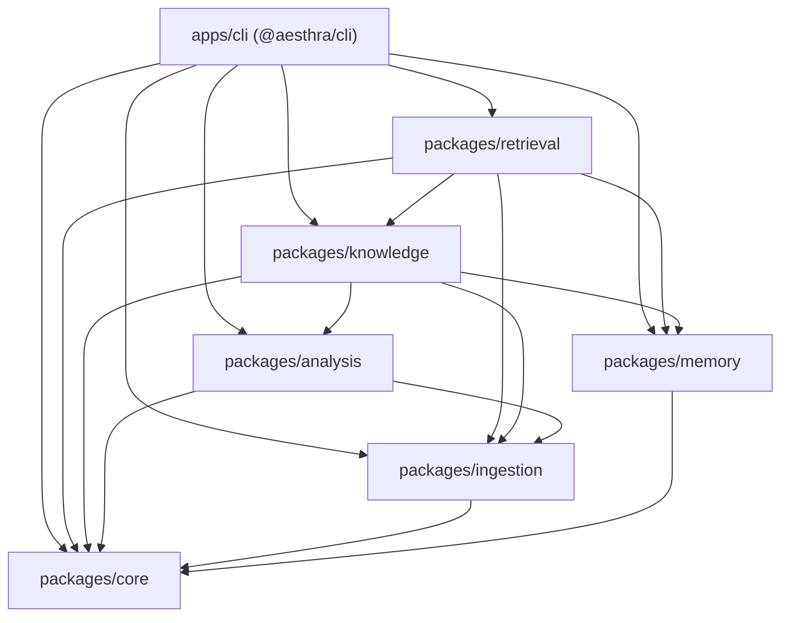

# Aesthra Architecture

Aesthra is a local-first TypeScript monorepo built on strict separation of **References**, **Knowledge**, **Memory**, and **Skills**, using filesystem storage and Zod schemas for transparency and durability.

## Package Dependency Graph

## Module Responsibilities

| Package              | Responsibility                                                                                      | Persistence                                  |
| -------------------- | --------------------------------------------------------------------------------------------------- | -------------------------------------------- |
| `@aesthra/core`      | Zod schemas, IDs, safe path checks, atomic file I/O, workspace discovery                            | None (shared primitives)                     |
| `@aesthra/ingestion` | Local media validation, SHA-256 hashing, image header dimensions, SSRF-safe URL normalization       | `references/catalog/*.json`                  |
| `@aesthra/analysis`  | Provider-independent `AnalyzerProvider`, `TechnicalMetadataAnalyzer`, structured JSON importer      | `references/analyses/*.json`                 |
| `@aesthra/memory`    | Personal Design DNA management and append-only event/decision logs                                  | `memory/design-dna.yaml`, `memory/*.jsonl`   |
| `@aesthra/knowledge` | Pattern Markdown serialization, extractor, deterministic comparator, learning inbox, atomic curator | `learning/inbox/*.json`, `knowledge/**/*.md` |
| `@aesthra/retrieval` | Progressive local keyword search across approved knowledge, references, and memory                  | Read-only query over workspace               |
| `@aesthra/cli`       | Thin Commander command handlers (`pnpm brain` / `aesthra`)                                          | Delegates to packages                        |

## Key Safety & Architectural Boundaries

1. **No direct writes to `knowledge/` or `memory/` from analysis**: Analysis produces immutable `CreativeAnalysis` artifacts; proposals sit in `learning/inbox/` until explicitly approved.
2. **Path traversal & conflict safety**: `resolveSafeTargetPath` guarantees proposals write only inside their allowed root directory (`knowledge/`, `memory/`, or `skills/`), preventing `..` traversal or symlink escapes. `baseFileHash` detects concurrent modifications before applying updates.
3. **Honest analysis**: Without a configured vision analyzer (`AESTHRA_VISION_PROVIDER`), `TechnicalMetadataAnalyzer` inspects only real file headers/bytes (and `ffprobe` for videos if installed) and records limitations in `uncertainty[]`.

## Future Architecture (Planned, Not Yet Implemented)

- **Vision & Video Adapters**: Implementations of `AnalyzerProvider` for multimodal image inspection and `ffmpeg` keyframe extraction.
- **Semantic Retrieval & Vector Stores**: Embedding-backed `KnowledgeRetriever` and `KnowledgeComparator` adapters (e.g., Qdrant) behind existing package interfaces.
- **Effect Registry**: Executable motion and visual effect modules (e.g., Remotion, GSAP) kept separate from conceptual `knowledge/` patterns.
