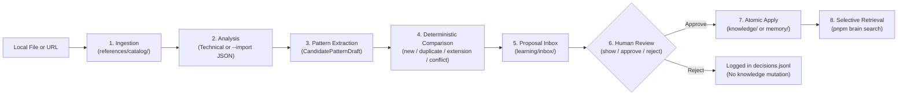

# Learning Workflow

Aesthra follows a deterministic, review-gated pipeline from raw inspiration to reusable knowledge:

**Collect -> Analyze -> Extract -> Compare -> Propose -> Review -> Integrate -> Retrieve**

## Stage Breakdown

### 1. Ingestion (`pnpm brain learn`)

- **Local files**: Validates extension and readability, computes `sha256` hash, inspects image dimensions natively (PNG, JPEG, GIF, WebP, SVG), checks for hash duplicates, and writes a `CreativeReference` JSON.
- **URLs**: Validates `http:` / `https:`, checks SSRF rules, normalizes canonical URL for deduplication, and registers metadata **without** scraping or downloading remote media.

### 2. Analysis (`pnpm brain analyze <ref-id>`)

- **Without `--import`**: Runs `TechnicalMetadataAnalyzer`. Records verifiable byte size, MIME type, and dimensions (plus `ffprobe` metadata for video if installed). Explicitly records uncertainty when no vision analyzer is configured. Never fabricates visual claims.
- **With `--import <file.json>`**: Validates a structured analysis JSON against `AnalysisImportInputSchema`, keeping direct `observations`, subjective `interpretations`, `uncertainty`, and `extractedPatterns` cleanly separated.

### 3. Extraction & Comparison (`pnpm brain propose <ref-id>`)

- Refuses to invent patterns from URLs or brief user notes alone (`insufficient_evidence`).
- Compares candidate patterns against existing `knowledge/**/*.md` entries using `DeterministicKnowledgeComparator`:
  - `new`: distinct new knowledge entry.
  - `similar`: distinct entry linked to related existing patterns.
  - `duplicate`: skipped by default so the knowledge base stays clean.
  - `extension`: proposes an `update` to enrich an existing entry while recording `baseFileHash`.
  - `conflict`: flags contradiction with high-severity conflict details for explicit human resolution.

### 4. Review & Integration (`inbox`, `show`, `approve`, `reject`)

- `inbox` lists pending proposals; `show` prints rationale, evidence, conflicts, and Markdown preview.
- `approve <id> --yes` validates safe workspace target paths, checks `baseFileHash`, writes atomically, updates proposal status to `applied`, and logs to `memory/decisions.jsonl`.
- `reject <id>` updates proposal status to `rejected`, logs to `memory/decisions.jsonl`, and leaves `knowledge/` and `memory/design-dna.yaml` untouched.

